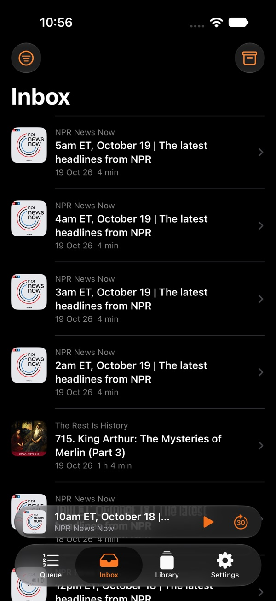
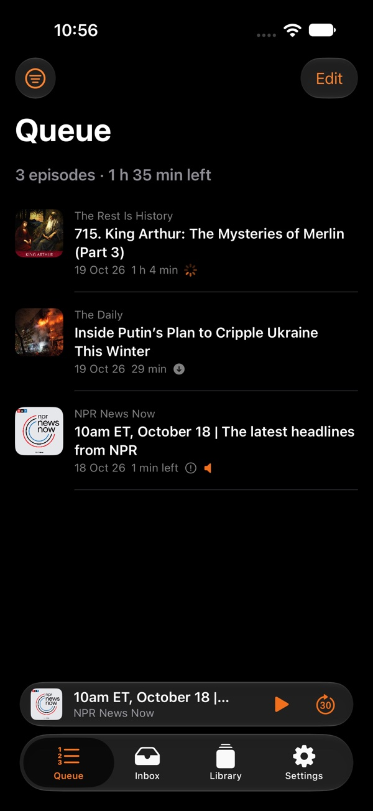
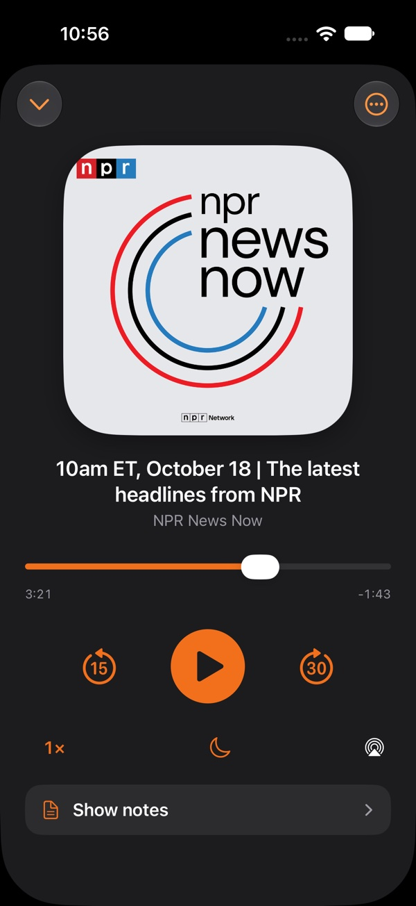

  

<h1 align="center">Opiuml: the podcast player for iPhone, iPad, Apple Watch and CarPlay</h1>

  <strong>Triage your podcasts. Play what matters.</strong> 
  <a href="https://opiuml.thechels.uk/">opiuml.thechels.uk</a> · <a href="https://apps.apple.com/gb/app/opiuml-podcast-player/id6823693348">Download on the App Store</a>

---

Opiuml is a podcast app for people who subscribe to more shows than they could ever listen to. It is built around two lists: an **Inbox** for every new episode, and a **Queue** for what you actually want to hear. Swipe to decide, and the rest quietly tidies itself away.

No accounts, no ads, no analytics and no tracking. Your podcast library lives on your device and syncs through your own iCloud.

  
  
  

## Inbox in. Queue out.

- **Inbox: swipe to decide.** Queue next, queue last or archive. Filter by audio, video or YouTube and clear the pile in minutes.
- **Queue: your play order.** Drag to reorder. Serial shows stay in story order, and you can see how long the whole queue will take at your playback speeds.
- **Now Playing: made for listening.** Big artwork, 15- and 30-second skips, variable speed, a sleep timer and show notes, all within reach.

New episodes can skip the Inbox and go straight into your Queue to play next or last, so daily news shows never pile up.

## Features

| | |
|---|---|
| **Per-podcast rules** | Choose where new episodes go, how many to keep, and set the playback speed and skip intervals for each show. Daily news can keep only today's episode. |
| **Chapters and show notes** | Chapters, artwork and show notes, with chapter skipping on the lock screen. |
| **Video podcasts and YouTube** | Video podcasts, YouTube channels via RSS, and your own audio files in one place. |
| **Apple Watch** | Send episodes to your wrist and listen without your phone. |
| **CarPlay** | Your Queue, Inbox and Library on the car dashboard. |
| **Groups and OPML** | Organise shows into groups, import and export OPML, and spot podcasts that have gone quiet. |
| **Stats and history** | Time listened, time saved, your top shows and full listening history. |
| **Siri and Shortcuts** | Siri Shortcuts and deep links make your listening easy to automate. |

## Private by design

Opiuml has no sign-up and collects nothing. There are no third-party analytics or trackers. Your subscriptions, queue and history stay on your iPhone and sync between your devices through your own iCloud account. Read the [privacy policy](https://thechels.uk/app/privacy).

## Pricing and requirements

- **Free to download**, then **£29.99 a year** after a **one-week free trial** for new subscribers
- iPhone and iPad with iOS / iPadOS 18 or later
- Apple Watch with watchOS 11 or later
- CarPlay

## FAQ

**Is Opiuml a good alternative to Overcast, Pocket Casts or Apple Podcasts?**
If you follow lots of shows and want to decide what gets played instead of drowning in a feed, yes. Opiuml's Inbox and Queue workflow makes podcast triage fast, and per-podcast rules automate the rest.

**Can I move my podcasts from another app?**
Yes. Export an OPML file from your current podcast player and import it into Opiuml.

**Does Opiuml play YouTube channels?**
Yes. Add a YouTube channel by its RSS feed and its videos appear alongside your podcasts.

**Where can I get it?**
Opiuml is [available now on the App Store](https://apps.apple.com/gb/app/opiuml-podcast-player/id6823693348) for iPhone, iPad, Apple Watch and CarPlay.

---

## About this repository

This repository is the source of [opiuml.thechels.uk](https://opiuml.thechels.uk/), a static HTML and CSS site deployed to GitHub Pages by [`.github/workflows/pages.yml`](.github/workflows/pages.yml) on every push to `main`. Dependabot keeps the workflow's actions up to date.

© 2026 Opiuml · [thechels.uk](https://thechels.uk/)
